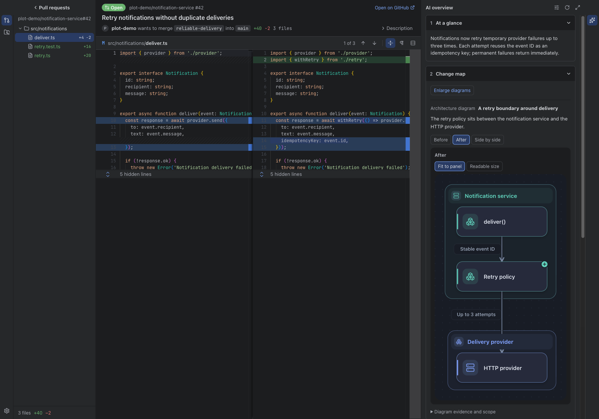
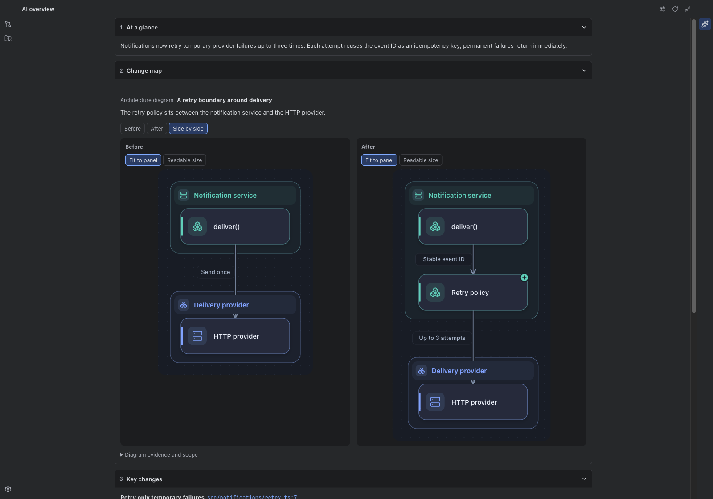
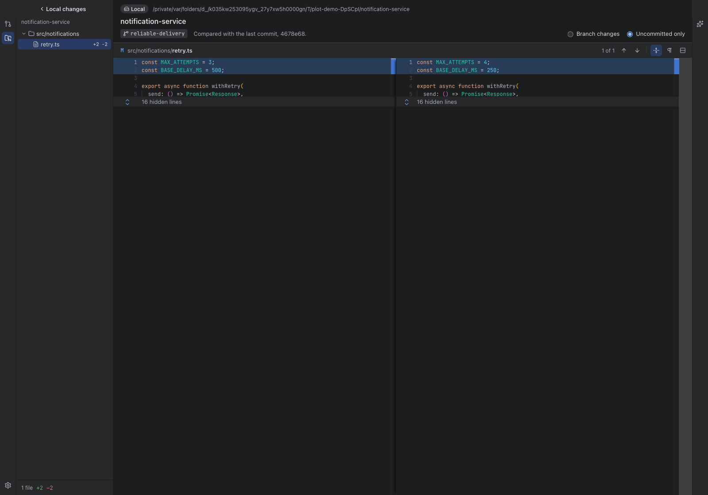

# Plot

**The story behind every change.**

A Mac app for understanding pull requests and local code changes. Read side-by-side diffs, follow the code, and use optional AI overviews to see what changed and why.

[](https://github.com/gentledev10/plot/actions/workflows/ci.yml)
[](LICENSE)



[Get started](#get-started) · [Watch the demo](#demo) · [User guide](docs/GUIDE.md) · [Report a bug](https://github.com/gentledev10/plot/issues/new/choose)

> Early development. A signed macOS release and Homebrew distribution are being prepared. For now, run Plot from source using the steps below.

## Why Plot

- **Read the change in context.** Browse GitHub pull requests or paste a PR URL. Navigate side-by-side or unified diffs with a file tree, collapsed unchanged lines and configurable shortcuts.
- **Understand the story.** Optional AI overviews explain the purpose, key changes and review questions, with before-and-after diagrams and links back to the code. Use your own Claude Code or Codex CLI account, and customize the review steps in Settings.
- **Read by purpose, not just by file.** Group a PR's implementation, tests and documentation by the behavior they change. Switch between the whole PR and a named change without generating another overview.
- **Ask and investigate.** Ask about a change or selected code, or start an AI code review for possible bugs. Findings are checked in a second session with the same AI tool when candidates are found; they are not confirmed bugs or a merge verdict.
- **Explore behavior, then compare actual results.** Try inputs and error cases in a bounded AI explanation model. Where supported, explicitly run the real function or related Node.js tests against isolated before-and-after snapshots. Model predictions and actual execution results stay separate; see [what can run](#explore-and-check-a-pull-request).
- **Check your work and selected commits.** Open a local repository to inspect uncommitted files or select one or several commits from a branch's history. Only the selected commits are included, not every commit between them. Request an optional AI overview without checking out another branch or changing your files.

## Get started

### Run from source

You need **macOS 13 or later**, **Git**, and **Node.js 22.12 or later**.

```sh
git clone https://github.com/gentledev10/plot.git
cd plot
npm ci
npm run dev
```

A GitHub account is needed for pull requests. Local changes work without signing in. AI tools are optional.

Dependency installation also downloads the Electron runtime. `npm run dev` and `npm run preview` check it again before starting, reusing an existing installation. The first download requires network access. If it fails, see [Electron setup troubleshooting](docs/TROUBLESHOOTING.md#electron-uninstall-when-running-from-source).

On macOS, `npm run dev` automatically prepares a locally signed development runtime named **Plot**, so the menu bar and Dock show Plot rather than Electron. This runtime is cached in the Git-ignored `.dev-runtime/` directory; it is not a packaged snapshot of the application. Every launch builds the current source, renderer edits refresh the window, and main/preload edits are watched. Updating Electron or the runtime preparation script or icon prepares a new runtime. No Apple signing account is needed; macOS may ask for Keychain access again when the development app identity changes.

### Read your first change

1. **Open local work:** choose **Open a local folder…** on the start screen, or **Local changes → Choose a folder…**, and pick a Git repository.
2. **Or connect GitHub:** open **Settings → Accounts** and connect through your browser, a personal access token or the GitHub CLI. Development builds use a one-time browser code.
3. **Open a pull request:** choose one from the list, or press **⌘O** and paste its URL. Select a file; use **F7 / ⇧F7** to move between changes.
4. **Add an AI overview, if you want one:** configure an installed, signed-in tool in **Settings → AI overview**, then choose **Review changes**. Select a cited code location to inspect its source.

See the [user guide](docs/GUIDE.md) for GitHub Enterprise, tokens, AI settings, languages, themes and the full shortcut list.

### Downloads and Homebrew

There is no public installer yet. Release builds will provide separate **Apple Silicon** and **Intel** downloads on [GitHub Releases](https://github.com/gentledev10/plot/releases).

Homebrew installation will use a project-maintained tap after the first signed release; it is not available yet. The [release guide](docs/RELEASING.md) covers signing, notarization, checksums and generating the cask. An official Homebrew Cask listing is a separate submission.

## Demo

https://github.com/user-attachments/assets/17e9ebc0-0720-476c-9687-ba9919cdfa7c

Open a PR, inspect the diff, follow a diagram back to its code and open local work. [Download the English demo](https://github.com/gentledev10/plot/raw/refs/heads/main/docs/media/plot-demo.mp4).

Screenshots and the demo are captured from the real app in English using an illustrative repository and a prepared overview. They do not show a live AI request or its generation speed, and predate the newer reading, question and execution controls described below.

### See how the structure changes



Compare the structure before and after a change, then follow verified current-code links. Architecture, processing flow and call-sequence views explain different kinds of changes.

### Keep up with local work



Use the same diff viewer for your own work and changes produced by coding agents. **Uncommitted only** compares staged, unstaged and untracked files with `HEAD`. **Selected commits** lets you browse a branch's history and choose only the commits you want to inspect; selections with missing dependencies can conflict, which Plot reports rather than including omitted commits. Choose **Explain local changes** for an optional overview. Local selections do not support PR-specific questions, AI code review or actual code execution.

## Explore and check a pull request

After choosing **Review changes**, use the overview to move from explanation to evidence:

1. **Focus the reading.** **Read by change** groups related code, tests and documentation. Use **Scope** to switch between **Whole PR** and an individual change; the saved overview, diagrams and source links stay connected.
2. **Ask a question.** Use **Ask about this change**, or select code on either side of the diff and choose **Ask about selected code**. Check the displayed scope and submit explicitly. Selecting code, typing or changing scope never sends a request by itself.
3. **Look for possible bugs.** In **AI code review**, choose **Find possible bugs**. A fresh AI session inspects the code; if it reports candidates, a second session with the same tool checks their evidence. This does not execute code or tests, and the findings are not confirmed defects or an approval.
4. **Try an explanation model.** Expand **Try inputs and error cases** for supported conditional logic. Adjust inputs or choose boundary and failure scenarios to compare predicted paths and results. This bounded model does not run repository code or measure test coverage; broader calculations, loops and concurrency are outside its scope.
5. **Run a supported comparison.** When a model has an executable function binding, choose **Run actual code with these values** to compare its real return value or exception. **Compare tests with Node.js** runs related changed tests against both versions using the PR-head assertions in each. Inspect the raw output: a difference may be intended, and a setup failure is not proof of a bug.

Actual execution uses isolated merge-base and PR-head snapshots and requires an available macOS sandbox and a compatible installed Node.js runtime (22+ with the required test flags). It runs only on your explicit click, with network access, private file contents and child processes blocked, and writes confined to temporary scratch space. Plot does not install dependencies or run package scripts. Only tests that run directly with Node's built-in test runner are supported—not Vitest, Jest or tests requiring installed dependencies. Functions needing service/browser setup, object arguments or unavailable dependencies may not run. Results cover only the selected inputs or test files and last for the current app session.

See the [PR reading and execution guide](docs/GUIDE.md#read-and-check-a-pr-by-purpose) for scope, supported inputs and execution limits.

## AI, your code and cost

Plot is free and open source. **AI usage is handled by your chosen provider under your account's plan or API pricing.** Plot does not include an AI subscription.

- **Optional:** read PRs and local diffs without AI. Overviews require Claude Code 2.1.248 or later, or an up-to-date Codex CLI, with a supported sign-in or your API key.
- **Data:** analysis runs through the CLI on your Mac, which sends analysis input to its AI provider. PR inputs include the diff and description, changed directories, repository file paths and bounded architecture context. Local inputs contain only the selected diff and selected before/after text-file snapshots, not broader repository context. Plot has no analysis server of its own; this is not offline AI.
- **Credentials:** API keys and stored GitHub tokens are encrypted using the macOS keychain. GitHub CLI connections request the token when needed without storing a copy.
- **Controls:** AI tools run with file-write and tool/network restrictions. Cited locations are checked against source; the explanation can still be wrong. Actual code execution is a separate, explicit sandboxed action, not something the AI tool runs automatically. You make the review decision.
- **Reuse and new requests:** overviews are cached locally per commit and language. Reopening one or switching reading scope does not generate another AI request. Questions and AI code reviews send new requests to your selected tool and count toward its usage; a bug review may use two sessions.

Read [AI setup and data access](docs/GUIDE.md#ai-overviews-and-your-code) and the [trust boundaries](docs/ARCHITECTURE.md#trust-boundaries) for the exact restrictions and their limits.

## Supported today

| Area           | Support                                                                             |
| -------------- | ----------------------------------------------------------------------------------- |
| Platform       | macOS 13+; Windows and Linux are not supported                                      |
| Pull requests  | GitHub.com and GitHub Enterprise Server; GitLab and Bitbucket PRs are not supported |
| Local work     | Git repositories, selected commits, and uncommitted files                           |
| AI overview    | Pull requests and explicitly selected local changes                                 |
| PR follow-up   | Scoped code questions and two-pass AI code review for possible bugs                 |
| PR execution   | Supported functions and Node.js tests in isolated before-and-after snapshots         |
| Review actions | Read and understand changes; comments, approvals and merging stay on GitHub         |
| Languages      | English and Korean; the overview language can be selected separately                |
| Appearance     | Light, Dark and Darcula, code fonts, colors and resizable panels                    |

For setup problems, see [Troubleshooting](docs/TROUBLESHOOTING.md). Report a reproducible bug or suggest a feature in [Issues](https://github.com/gentledev10/plot/issues/new/choose). Planned distribution work is tracked in the [release guide](docs/RELEASING.md).

## Development and contributing

[CONTRIBUTING.md](CONTRIBUTING.md) covers setup and checks. See [ARCHITECTURE.md](docs/ARCHITECTURE.md) for the app structure, [MEDIA.md](docs/MEDIA.md) to reproduce the English captures, and [RELEASING.md](docs/RELEASING.md) for packaging.

```sh
npm run lint
npm run typecheck
npm test
npm run build
```

On macOS, `npm run test:e2e` checks the real Electron app with isolated GitHub and AI fixtures. Report security issues privately as described in [SECURITY.md](SECURITY.md).

## License

[MIT](LICENSE). Bundled libraries, fonts and adapted theme colors retain their own licenses; see [THIRD_PARTY_NOTICES.md](THIRD_PARTY_NOTICES.md). Packaged builds include full notices under **Help → Open Source Licenses**.
